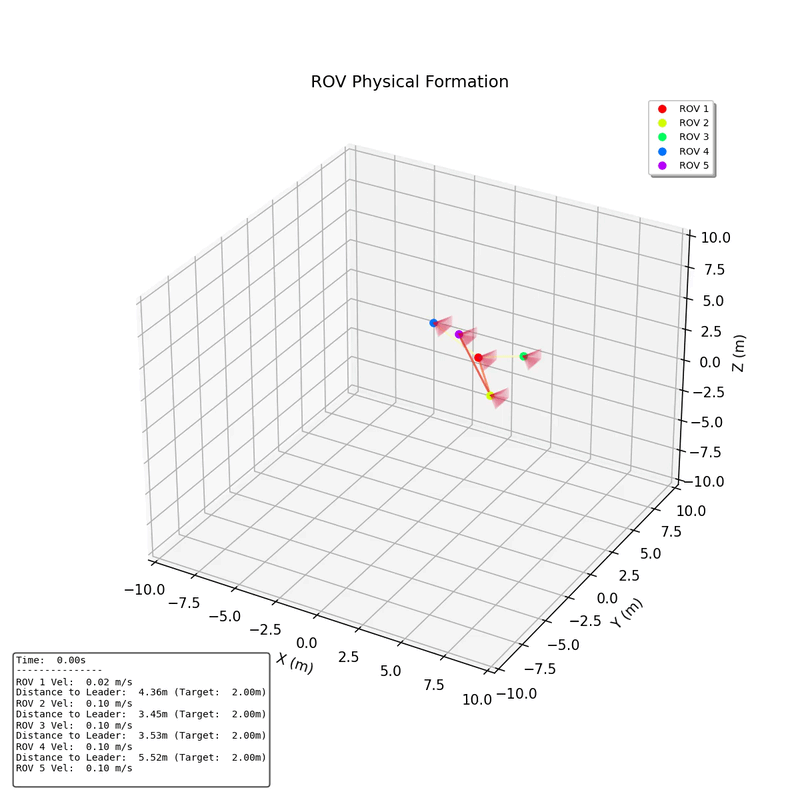
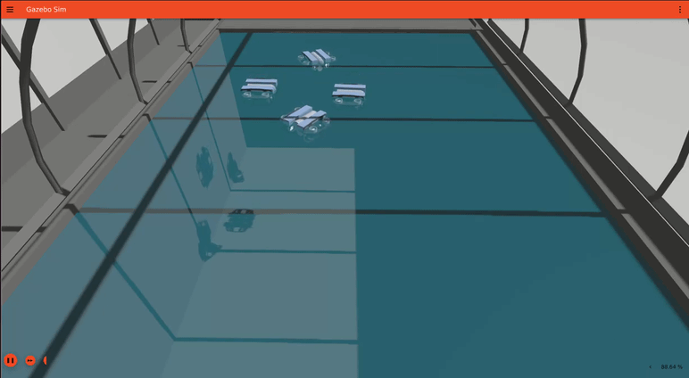
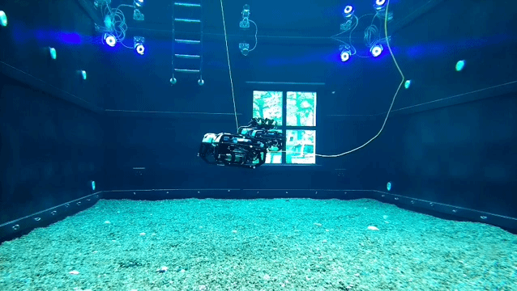

# Sensor-based Formation Control of Underwater Multi-Robot Systems Using Barrier Lyapunov Functions

MSc thesis project, KTH Royal Institute of Technology, Stockholm.

**Author:** João Zenário
**Supervisors:** Nicola De Carli, Victor Nan Fernandez-Ayala
**Examiner:** Dimos Dimarogonas

### From simulation to the pool

The controller was developed in three stages, each adding realism.

1. **Python simulation:** the formation controller is first tested with idealised vehicle dynamics. This is where the recentred Barrier Lyapunov Functions are tuned and the safety constraints (collision avoidance, connectivity, field of view and boundary avoidance) are checked in isolation.

    <p align="center">
      
    </p>

2. **Gazebo simulation:** the same controller runs on BlueROV2 Heavy models through the full ROS 2 and PX4 stack. This exposes the effects the idealised model hides, such as actuator allocation, communication timing and offboard control behaviour.

    <p align="center">
      
    </p>

3. **Real experiment:** two BlueROV2 Heavy vehicles are tested at the KTH Marinarium, with Qualisys motion capture providing ground truth. The hardware runs confirm that the safety constraints hold in practice and that they improve formation accuracy rather than degrading it.

    <p align="center">
      
    </p>

## Overview

This repository contains the code, data and analysis tools developed for my MSc thesis on formation control for underwater multi-robot systems with limited, sensor-based perception.

The core contribution is a **control Lyapunov function quadratic program (CLF-QP)** formation controller that uses **recentred Barrier Lyapunov Functions (BLFs)** to enforce several safety requirements at once:

- inter-robot collision avoidance
- connectivity maintenance between neighbours
- camera field-of-view (FoV) compliance
- pool boundary avoidance

### Key insight

Standard barrier functions are centred on the origin of the constraint, which can conflict with the desired formation offset and degrade tracking. Recentring each BLF so that its minimum aligns with the desired formation offset removes this conflict. In the experiments, the safety constraints did not trade off against performance. They actually improved formation accuracy.

## Validation

The controller was validated in three settings:

- **Python simulation:** idealised dynamics, used for design and tuning.
- **Gazebo simulation:** BlueROV2 Heavy vehicles with the full ROS 2 and PX4 stack.
- **Real experiments:** two BlueROV2 Heavy ROVs at the KTH Marinarium, with Qualisys motion capture as ground truth.

The BlueROV2 Heavy is a fully actuated platform. The software stack is ROS 2 with PX4 (via the XRCE-DDS bridge).

## Repository structure

> Update this section to match the actual layout of the repository.

```
.
├── src/                 # Controller and ROS 2 packages
├── simulation/          # Python simulation, Gazebo worlds, launch files and vehicle models
├── experiments/         # Hardware launch files and configuration
├── data/                # Recorded telemetry (.npz) from simulation and experiments
├── analysis/            # Plotting utilities and formation error analysis
├── thesis/              # LaTeX source of the thesis
└── docs/
    └── media/           # Animations used in this README
```

## Requirements

- Ubuntu [XX.XX]
- ROS 2 [distribution]
- PX4-Autopilot [version] and matching `px4_msgs`
- Micro XRCE-DDS Agent
- Gazebo [version]
- Python [version] with the packages listed in `requirements.txt`
- (Experiments only) Qualisys MoCap system and a ROS 2 MoCap driver

> `px4_msgs` must match the PX4 firmware version exactly. A mismatch is the most common cause of silent communication failures.

## Getting started

### 1. Clone and build

```bash
git clone [repository-url]
cd [repository-name]
colcon build --symlink-install
source install/setup.bash
```

### 2. Run the Python simulation

```bash
# Replace with the actual command
python simulation/[script_name].py
```

### 3. Run the Gazebo simulation

```bash
# Replace with the actual launch command
ros2 launch [package] [simulation_launch_file].py
```

### 4. Run the real experiments

```bash
# Replace with the actual launch command
ros2 launch [package] [experiment_launch_file].py
```

Notes for hardware runs:

- Use a separate `ROS_DOMAIN_ID` for each robot (or an equivalent DDS isolation setup) to avoid cross-talk between vehicles.
- Check that the offboard heartbeat is published at the required rate before arming.
- Verify the control allocator configuration for the BlueROV2 Heavy frame before the first run.

## Data analysis

Recorded telemetry is stored as `.npz` files in `data/`. The `analysis/` folder contains:

- plotting utilities for trajectories, control inputs and barrier values
- a topology-aware formation error analysis pipeline
- a script that recomputes FoV bearing angles from logged poses

```bash
# Example
python analysis/[script_name].py --input data/[file].npz
```

## Thesis

The full thesis is available at: [link to DiVA / PDF]

The LaTeX source is in `thesis/`. To build it:

```bash
cd thesis
latexmk -pdf main.tex
```

## Citation

If you use this work, please cite:

```bibtex
@mastersthesis{zenario2026formation,
  author  = {Zen{\'a}rio, Jo{\~a}o},
  title   = {Sensor-based Formation Control of Underwater Multi-Robot Systems Using Barrier Lyapunov Functions},
  school  = {KTH Royal Institute of Technology},
  year    = {[year]},
  address = {Stockholm, Sweden}
}
```

## Acknowledgements

Thanks to my supervisors Nicola De Carli and Victor Nan Fernandez-Ayala, and to my examiner Dimos Dimarogonas, for their guidance. Thanks also to the KTH Marinarium team for their support with the experimental setup.

## Licence

[Choose a licence, e.g. MIT or BSD-3-Clause, and add a `LICENSE` file.]

## Contact

João Zenário: [email or LinkedIn / GitHub profile]
